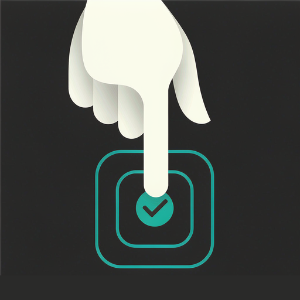

<div align="center">



# Surehand

**让 agent 操作电脑时，说得出「凭什么」。**

桌面与浏览器自动化，一套协议，两个平台（macOS / Windows）。
每一次观察都带证据，每一次动作都带回执，每一个令牌都带发证条件。

[](#实测)
[](#平台能力)
[](#零依赖)
[](LICENSE)

</div>

---

## 一句话说清它解决什么

Agent 操作 GUI 的失败，几乎都不是「没点中」，而是**点中了却不知道点中了什么**：

- 元素读不到，被当成「页面是空的」；
- 点击发出去了，被当成「已经点了」；
- ref 编号被复用，旧令牌静默指向了另一个按钮。

Surehand 的做法是把这三件事都拆开、都留证据：读不到就说读不到（`Unknown`，不塌缩成 `false`），发出去不等于送达（`uncertain` 单独一档），编号永不复用（旧令牌直接失效，绝不改指）。

---

## 四个机制，构成全部的差异

### 1. 证据三态：`known` / `absent` / `unknown`

一个谓词的答案有三种，不是两种。`enabled` 可能为真、为假，也可能**问不出来**——元素不支持该属性，或者读的时候失败了。

把 `unknown` 压成 `false`，就会得到「按钮不可用，跳过」这种自信的错误结论。Surehand 的三态在合并时也不塌缩：只要有一处 `unknown`，整体就是 `unknown`，动作层会拒绝动手而不是猜。

```bash
$ surehand do click --ref d:e12
失败 AMBIGUOUS（ambiguous）：命中多个，补 role / id / contains 收窄
    投递=not_delivered 重试=unsafe
```

### 2. 令牌分三档，按「动作会不会落到坐标上」发放

| 档 | 发证条件 | 允许的动作 |
|---|---|---|
| **完整令牌** | 整窗完整遍历 + 身份整窗唯一 + 字段全读到 | 全部 |
| **受限令牌** | 前两条满足 + `AXIdentifier` 非空唯一（字段有 `unknown`） | 只许填值 / 读取 |
| **导航句柄** | 其余情况 | 只能继续观察，动手报 `HANDLE_NOT_TOKEN` |

这不是「读得全才让动」，而是按风险分级：`AXSetValue` 不经坐标、不看可见性、不受遮挡，风险模型与点击不同。用一个标准卡所有动作，结果就是文本框里明明能安全写入，却被逼去截图盲点。

**令牌编号在本进程内单调递增，永不复用。** 两次观察之间，`e12` 不会变成另一个元素——旧令牌要么还能用，要么明确 `REF_STALE`。

### 3. 投递语义三轴：发出去 ≠ 送达

| 结局 | 含义 | 重试 |
|---|---|---|
| `delivered` | 应用层返回了动作结果（`ax_action_result`） | — |
| `not_delivered` | 明确没送到（被拒、无路径、歧义） | safe |
| `uncertain` | 事件已投递，但没人确认收下（`event_posted`） | **unsafe** |

写路径绝不复用读路径的「可重试」判定。`uncertain` 之后必须再观察一次，这是纪律，不是建议。

### 4. 出错时给的是码，不是散文

调用方是程序的时候，「点了没成功，因为目标已不在」这句话没有用——它没法分支。

所以失败一律是结构化的：错误码 + 类别 + **能不能重试** + 该怎么办。

```json
{"ok": false, "error": "REF_STALE", "kind": "stale", "retry": true,
 "hint": "目标已不在，重新 look"}
```

`kind` 分得比「成功/失败」细：`stale`（重新看）、`ambiguous`（收窄条件）、
`occluded`（被挡住）、`bad_input`（参数写错了，**别去 look**）、`bug`（是我们的问题，别重放）。

带 `--json` 时，**任何**失败路径都保证输出合法 JSON——包括参数写错、文件读不到、
甚至工具自身的意外异常。这条由自测 B13 盯死，不是口头承诺。

---

## 能操作什么

| 场景 | 走哪条路 | 状态 |
|---|---|---|
| 原生应用（计算器、访达、文本编辑、系统设置） | 可访问性树，语义定位 | 稳定 |
| 浏览器页面（Chrome / Edge / Chromium） | CDP，快照含可操作 + 只读节点 | 稳定 |
| 网页表单、下拉、复选框 | 语义定位 + 值回读 | 稳定 |
| 自绘界面（微信、抖音、Qt / CEF 应用） | 判为视觉面，截图 + 窗口内点数 | 可用，精度靠人 |
| 多窗口、多显示器 | 窗口相对坐标 | 单屏验证过，多屏未逐屏换算 |
| 资源管理器 / UIA 应用 | UIAutomation | **beta**，未实机验证 |

---

## 三种接法，同一个内核

### MCP（推荐）

```json
{
  "mcpServers": {
    "surehand": {
      "command": "python3",
      "args": ["/absolute/path/to/surehand/scripts/mcp_server.py"]
    }
  }
}
```

标准 stdio JSON-RPC，零第三方依赖，12 个工具。Claude Code、Cursor、Codex、WorkBuddy 以及任何支持 stdio MCP 的客户端都认。各宿主的配置文件位置见 [AGENTS.md](AGENTS.md)。

### 命令行

```bash
surehand up
surehand look --app 微信
surehand do click --ref d:e12
```

退出码即结论：`0` 送达 / `1` 未送达 / `2` 不确定。全部命令支持 `--json`。

### 技能格式

复制到宿主技能根，宿主读 `SKILL.md`：

```bash
./install.sh ~/.dsh/skills/surehand
./install.sh ~/.workbuddy/skills/surehand
```

---

## 装

### macOS

```bash
git clone https://github.com/newdwp1985-eng/surehand.git
cd surehand
./install.sh ~/.workbuddy/skills/surehand     # 或任意目标目录
surehand up                                   # 首次会自动编译引擎
```

需要 Xcode Command Line Tools（`xcode-select --install`）。引擎是 Swift 单文件，编译约 7 秒，产物在 `engine/macos/bin/mccd`。

授权：**谁执行命令，就在「辅助功能」和「屏幕录制」里勾谁**。让终端跑就勾终端；让 WorkBuddy 跑就勾 WorkBuddy。

### Windows

```powershell
.\install.ps1 -Target "$env:USERPROFILE\.workbuddy\skills\surehand"
surehand up
```

零安装依赖：系统自带的 Windows PowerShell 5.1 + .NET UIAutomation 就够，不编译、不装运行时。

**Windows 侧尚未在实机验证。** 仓库带了一键验收：

```powershell
powershell -ExecutionPolicy Bypass -File engine\windows\verify.ps1
```

它起记事本当靶子跑 12 项检查。在你跑出全绿之前，把 Windows 当 beta 用。

### 浏览器通道（可选）

浏览器**启动时**没带 `--remote-debugging-port`，事后无法补开。用内置命令起一个：

```bash
surehand launch          # 独立 profile，不影响日常那个 Chrome
```

它在 `~/.surehand/chrome-profile` 里单独开一个实例，登录态独立——需要登录的站点要在这个窗口里登一次。

---

## 实测

同一台机器（Apple Silicon，Chrome 157，计算器 / 访达 / 微信 / 文本编辑）：

| 场景 | 数据 |
|---|---|
| 计算器整窗快照 | 35 节点 / 30–95 ms |
| 访达大树快照 | 201 节点 / 303–371 ms |
| 同上 `--depth 3` | 84 节点 / 26–29 ms（**8.3×**） |
| 同上 `--from` 钻进子树 | 14 节点 / 44.5 ms |
| 微信快照 | 6 节点 → 判为视觉面（不是「空页面」） |
| 应用层点击回执（AXPress） | 104 ms |
| 坐标事件往返（CGEvent） | 0.155 ms |
| 引擎被 `kill -9` 后自愈 | 114 ms |
| 8 客户端并发 | 全部成功，仍单实例 |

自测 27 项、0 跳过，覆盖纯判断层、真实引擎、网页通道、MCP 协议：

```bash
python3 scripts/selftest.py
```

本机结果：`27/27 通过，0 项跳过`。

---

## 架构

```
         ┌──────────────────────────────────────────────┐
         │  MCP server  ·  CLI  ·  SKILL.md             │   三种入口
         └───────────────────┬──────────────────────────┘
                             │
         ┌───────────────────▼──────────────────────────┐
         │  evidence.py   三态合并 · 令牌分级 · 投递判定 │   判断层（纯函数）
         └───────┬───────────────────────────┬──────────┘
                 │                           │
     ┌───────────▼──────────┐    ┌───────────▼────────────┐
     │ transport.py（桌面）  │    │ web.py（网页）          │   通道适配
     │ AF_UNIX / 回环 TCP    │    │ 子进程 + 身份复核       │
     └───────────┬──────────┘    └───────────┬────────────┘
                 │                           │
     ┌───────────▼──────────┐    ┌───────────▼────────────┐
     │ mccd.swift           │    │ fastlane.py            │   引擎
     │ AX + CGEvent         │    │ CDP 四层降级            │
     │ wccd.ps1             │    │                        │
     │ UIA + SendInput      │    │                        │
     └──────────────────────┘    └────────────────────────┘
```

判断层是两个平台共用的纯函数，所以「什么算送达」「什么时候发令牌」只有一份实现，不会两端漂移。

细节见 [docs/architecture.md](docs/architecture.md)、[references/contract.md](references/contract.md)、[references/method.md](references/method.md)。

---

## 边界（不硬撑）

- **自绘界面读不到结构。** 微信主界面只有 6 个节点，抖音同类。此时走视觉面，精度取决于截图与坐标，不是语义保证。
- **iframe 内部元素不在主文档快照里。** 快照会如实报 `frame_count`，不会假装页面为空，但也不递归进 frame。
- **多显示器未做逐屏缩放换算。** 单屏（含 Retina 2×）已验证；窗口跨屏时 `scale` 可能取错。
- **Windows 未实机验证。** 结构完整，等 `verify.ps1` 出全绿。
- **等待仍是轮询。** `AXObserver` 未接，变化检测靠 10 ms 间隔轮询。
- **没有开机自启。** 引擎在首次调用时拉起，不常驻系统。

---

## 零依赖

Python 侧只用标准库（`json` / `subprocess` / `socket` / `pathlib`），没有 `pip install` 这一步。macOS 引擎是单个 Swift 文件，Windows 引擎是单个 PowerShell 文件，两端都不引第三方包。浏览器层手写了 WebSocket 客户端，也不依赖 `websocket-client`。

---

## 设计来源

三态证据、ref 捕获证明、投递语义这几个概念的成形，受益于对 [vercel-labs/agent-desktop](https://github.com/vercel-labs/agent-desktop) 的源码研读（Apache-2.0）。本项目的实现与取舍另有记录：`references/method.md` 里写了在哪些地方主动偏离了它，以及为什么。

---

## License

MIT。见 [LICENSE](LICENSE)。
